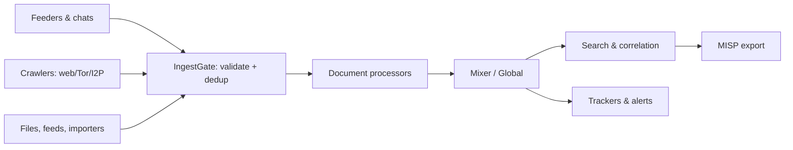

<h1 align="center">Black Pearl</h1>

<p align="center">
  Collect, crawl, process and analyse unstructured intelligence — from the clear web, Tor, I2P, chats, files and feeds — and turn messy raw content into searchable, correlated intelligence.
</p>

<p align="center">
  <a href="https://github.com/arhaan-art/black-pearl">github.com/arhaan-art/black-pearl</a> ·
  <a href="./docs/ingestion.md">Ingestion &amp; document-processing docs</a> ·
  <a href="./HOWTO.md">HOWTO</a> ·
  <a href="./doc/api.md">API</a>
</p>

---

## What is Black Pearl?

Black Pearl is an open-source intelligence platform for working with **messy, real-world data**: free text, screenshots, PDFs, office documents, archives, chat messages, encoded payloads, and content collected from websites, Tor hidden services and I2P.

Instead of treating each source separately, Black Pearl normalizes everything into typed, deduplicated, provenance-tracked objects that can be searched, tracked, correlated and exported.

**Intelligence lifecycle**

1. **Collection** — continuous ingestion from chats, websites, hidden services, files and feeds.
2. **Processing** — extraction, decoding, OCR, QR/barcode parsing, enrichment and tagging.
3. **Detection** — real-time tracking with words, sets, regex, typo-squatting and YARA.
4. **Analysis** — unified search, pivoting, correlation graphs and investigations.
5. **Dissemination** — export of findings and objects to [MISP](https://github.com/MISP/MISP).

## Architecture

```text
  Feeders / Chats     Crawlers (Lacus)      Files / Feeds / Importers
  (TG/DC/Matrix…)     web · Tor · I2P       PDF · image · archive · office
        \                   |                        /
         \                  v                       /
          +---------->  Unified Ingestion Engine  <----------+
          |   envelope (blackpearl.ingest/v1) · strict gate  |
          |   SHA-256 + metadata dedup · provenance · retry  |
          |   dead-letter queue + replay · collection history|
          +--------------------+-----------------------------+
                               v
                    Document Pipeline (processors)
          PDF · image/OCR · archive · office · metadata
          QR/barcode · language/translation · near-dup
          confidence scores · historical reprocessing
                               |
                               v
              Mixer -> Global -> Modules / Indexer
          trackers (word/regex/YARA) · search (Meilisearch)
          correlations · investigations · MISP export
```



Design principles, borrowed from Apache NiFi, the MISP Core Format and OpenTelemetry:

- **Envelope, not payload** — every ingest unit carries an immutable content reference, typed attributes, source identity and a UUID; database IDs stay local.
- **Lineage as data** — provenance, sightings and W3C `traceparent` context are append-only side records, enabling replay and audit without mutating source records.
- **Flow control at the edges** — bounded queues, per-record penalize, processor yield, and a retry budget that ends in a dead-letter queue. Distinct mechanisms, not one retry loop.
- **Interop by convention** — MISP category/type validation and OpenTelemetry-style semantic attribute names, with pinned schema versions.

Full design: [docs/ingestion.md](docs/ingestion.md).

## Unified ingestion engine

Location: `bin/lib/ingest/` — integrated into the existing `Importers → Mixer → Global` queue spine. No existing importer or module was replaced.

| Component | What it does |
|---|---|
| `envelope.py` | `IngestEnvelope` / `ContentRef` / `ProvenanceEvent` (`blackpearl.ingest/v1`, W3C `traceparent`) |
| `validate.py` | Strict schema gate — malformed or incomplete records never reach downstream processing |
| `dedup.py` | Content-fingerprint (SHA-256) + metadata-fingerprint deduplication, optional TLSH fuzzy |
| `provenance.py` | Append-only provenance and sightings (`prov:{uuid}`, Redis-optional) |
| `retry.py` | Backoff retry, penalize/yield, `DeadLetterQueue` (`ingest:dlq`) with replay |
| `adapters.py` | 7 source adapters: feeder JSON, chat, website/crawler, file, feed, importer |
| `pipeline.py` | Configurable stages (INI/JSON/YAML) + legacy bridge `<source> b64(gzip)` for backward compatibility |
| `UnifiedImporter.py` | Bridges envelopes to the legacy Mixer queue format (dry-run without Redis) |
| `IngestGate.py` | Module gate: `Importers-pre → Importers` |

Collection history, timestamps and provenance are recorded for every record. Failed ingestions land in the DLQ and can be inspected and replayed:

```bash
python3 tools/ingest_replay.py --list          # DLQ depth
python3 tools/ingest_replay.py --replay-all   # replay after fixing the cause
python3 tools/bench_ingest.py 500             # ingestion throughput benchmark
```

## Document & multimedia pipeline

Location: `bin/lib/ingest/processors/` — modular processors behind a priority registry. Every engine is `available()`-gated: if a tool is missing, the pipeline degrades to the next processor instead of failing ingestion.

- **PDF** — native text-layer extraction (PyMuPDF), embedded-file children, OCR path for scanned pages; PDFs are now full-text searchable.
- **Images & OCR** — quality scoring with confidence bands (≥0.85 accept, 0.60–0.85 flag, <0.60 automatic reprocessing cascade, best result always kept).
- **QR / barcodes** — structured results (content, format, decoder, polygon) via zxing-cpp → OpenCV → pyzbar.
- **Archives & office** — zip/tar/gzip recursion and OOXML parsing; legacy OLE routed to Apache Tika.
- **Metadata** — normalized canonical fields (`dc:title`, `doc.page_count`, `exif.gps_*`, …) with ISO-8601 dates.
- **Language & translation** — detection routed through strict BCP-47 normalization; translation providers degrade to "unavailable" offline, never fail.
- **Duplicates** — exact hash, metadata fingerprint, and MinHash near-duplicate detection on normalized text.
- **Confidence & errors** — per-stage confidence scores and typed errors linked to provenance; exhausted retries go to the DLQ.
- **Historical reprocessing** — a processed-document registry (`docproc:registry:{sha256}`) detects stale documents when extractor capabilities improve and queues them for `DocReprocessor`, overwriting old results only when confidence improves.

Configuration lives in [`configs/ingest.cfg`](configs/ingest.cfg) (`[docproc]` section). Processor and adapter development guides are in [docs/ingestion.md](docs/ingestion.md).

### Toolchain status (verified on the dev host)

| Tool | Status |
|---|---|
| OpenCV 5.1 + zxing-cpp | Verified — QR decode exercised in benchmarks |
| Apache Tika 3.3.3 + Java 17 | Jar installed; live `/rmeta` verification pending server start |
| Tesseract OCR | Blocked on Amazon Linux 2023 (no distro package) — use the Ubuntu Dockerfile |
| OCRmyPDF 17.x | Installed in `.venv-docproc`; blocked without the Tesseract binary |
| PaddleOCR | Optional isolated venv (`.venv-paddle`); engine stays gated off until installed |

Nothing above is claimed as working without a recorded verification command — see the "Not verified" list in [docs/ingestion.md](docs/ingestion.md).

## Search (keyword + hybrid)

Location: `bin/lib/search_engine.py` + `bin/lib/search_embedding.py` — Meilisearch indexes fed from `get_search_document()` on chats, messages, user accounts, forum threads/posts, images, screenshots, domains, PDFs and OCR.

- **Keyword by default, hybrid behind a flag** — `[Search] hybrid_enabled = False` in [`configs/core.cfg.sample`](configs/core.cfg.sample) is pure keyword search and the rollback; no vector is sent while it is off.
- **Hybrid** — `sentence-transformers/paraphrase-multilingual-MiniLM-L12-v2` (384d, chunked + mean-pooled, CPU) with a deterministic hash fallback that never blocks indexing; blend via `semantic_ratio` (default `0.4`, per-index overrides).
- **Facets & explanations** — filter on `lang`, `source`, `entity_type`, `tags` and more; `explain` returns ranking scores, expanded terms and detected entities (UI: Hybrid radio, facet badges, Why-this-result panel).
- **Query handling** — entity detection (`.onion`, hashes, CVEs, crypto, emails) and crypto synonym expansion (`btc` ↔ `bitcoin`, …); multilingual vectors match French queries to English documents.

Verified offline (46-doc independent corpus, BM25+cosine proxy — live Meilisearch is blocked on this host by glibc 2.34 < 2.35): hybrid-ST nDCG@10 `0.8629` vs keyword `0.7374`, multilingual `0.3419 → 0.7754`, with an entity-query regression to manage (keep exact/entity search at a low ratio). Full guide, tuning and "Not verified" list: [docs/search.md](docs/search.md).

## Platform capabilities

- **Collection** — feeders for Discord, Telegram, Matrix and other chat/stream sources; crawling for clear web, Tor (.onion) and I2P, including authenticated sessions with cookies/local-storage reuse.
- **Processing** — full-text indexing, URL/hostname/email/credential extraction, crypto artifact detection, Base64/hex decoding, OCR, QR/barcode extraction, AI image descriptions, PDF metadata + translation, MISP Galaxy/Taxonomy tagging.
- **Detection** — word, set, regex, YARA and typo-squatting trackers with real-time tagging and webhook/email alerts, plus Retro Hunts of new YARA rules against historical data.
- **Analysis** — unified search (relevance/recency, date-range), correlation graphs across hashes, PGP, domains, favicons, usernames, CVEs, SSH keys, crypto and PDF metadata; investigation workflows.
- **Export** — objects and investigations to MISP, with automatic export on selected detections.


More screenshots: tracker/YARA, retro-hunt, crawled domains, decoded files, investigations and MISP export in [`doc/screenshots/`](doc/screenshots/).

## Quick start

```bash
git clone https://github.com/arhaan-art/black-pearl.git
cd black-pearl
git submodule update --init --recursive

# Debian/Ubuntu dependencies
./installing_deps.sh

# Start Black Pearl
cd bin && ./LAUNCH.sh -l
# Web UI: https://localhost:7000/  (credentials in DEFAULT_PASSWORD, removed after first change)
```

Requirements: Python 3.8+ for the platform. Size the deployment for expected collection volume, crawlers and active modules. Optional components (Lacus crawler, Meilisearch, translation, Tika server) need extra configuration — see [HOWTO.md](HOWTO.md) and [docs/ingestion.md](docs/ingestion.md).

### Document-pipeline environment (optional)

```bash
uv venv .venv-docproc --python 3.12
uv pip install --python .venv-docproc pymupdf Pillow opencv-python-headless zxing-cpp datasketch pytesseract ocrmypdf qrcode
# Apache Tika (extraction breadth): install Java 17+, unpack the Tika server, run on 127.0.0.1:9998 (localhost only — no auth)
# Tesseract/OCRmyPDF: use the Ubuntu Dockerfile (apt tesseract-ocr ocrmypdf) on non-Debian hosts
```

## Tests & benchmarks (verified)

```bash
# Ingestion engine (system python, no extra deps)
python3 -m unittest tests.test_ingest_comprehensive tests.test_ingest_engine   # 68 tests

# Document pipeline (docproc venv)
.venv-docproc/bin/python -m unittest tests.test_doc_benchmark tests.test_doc_pipeline \
  tests.test_ingest_comprehensive tests.test_ingest_engine                     # 110 tests

.venv-docproc/bin/python tests/benchmark_docproc.py   # writes tests/fixtures/docproc/benchmark_results.json
```

Verified results on the dev host (2 vCPU): ingestion validation ~250k rec/s, pipeline ~7k rec/s; born-digital PDF extraction CER 0.0068 at ~41 docs/s; QR accuracy 5/5; near-duplicate accuracy 1.0 on the synthetic ground-truth corpus. OCR accuracy is **not** yet measurable on this host (no Tesseract binary) and is reported as a degradation case, not a score. Full methodology: [docs/ingestion.md](docs/ingestion.md).

## Project layout

```text
bin/lib/ingest/          Unified ingestion engine (envelope, gate, dedup, DLQ)
bin/lib/ingest/processors/  Document pipeline (PDF, image/OCR, archive, office…)
bin/importer/            Importers incl. UnifiedImporter
bin/modules/             Processing modules incl. IngestGate, DocReprocessor
configs/                 modules.cfg (queue wiring), ingest.cfg (pipelines)
tools/                   ingest_replay (DLQ ops), bench_ingest
tests/                   Ingestion + docproc suites and benchmark corpus
docs/ingestion.md        Architecture, configuration, adapter/processor guides
doc/                     Platform and API documentation
```

## Documentation

- [docs/ingestion.md](docs/ingestion.md) — ingestion + document processing: architecture diagrams, configuration, adapter/processor guides, install status, verified benchmarks
- [docs/search.md](docs/search.md) — keyword + hybrid search: architecture, hybrid config and ranking tuning, facets/explanations, multilingual, install status, offline evaluation
- [doc/README.md](doc/README.md) — main platform documentation
- [doc/api.md](doc/api.md) — API documentation
- [HOWTO.md](HOWTO.md) — setup and operations guides

## Contributing

Add sources and processors through the documented interfaces — new ingestion adapters implement `IngestAdapter` (`fetch`/`normalize`/`health`); new document processors implement `BaseProcessor` and register in the processor registry. Keep engines `available()`-gated, add ground-truth tests, and never let malformed records bypass the validation gate. See the development guides in [docs/ingestion.md](docs/ingestion.md).

## Privacy, funding & license

Operate Black Pearl lawfully and within GDPR where it applies. Black Pearl is maintained as an independent team project; views expressed are the authors' only and do not reflect the European Union or the granting authority.

Licensed under the GNU Affero General Public License v3 or later. Copyright (C) 2014–2026 CIRCL and contributors — see [LICENSE](LICENSE) for the full text and copyright list.


