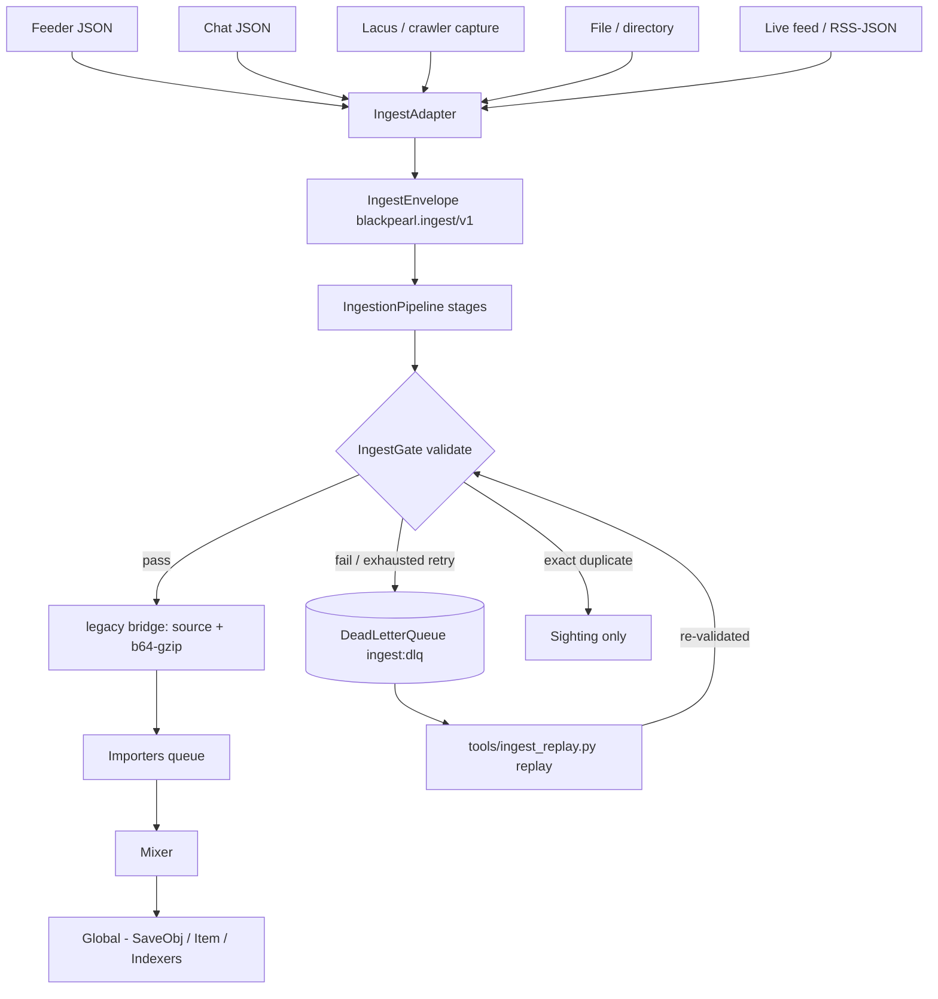
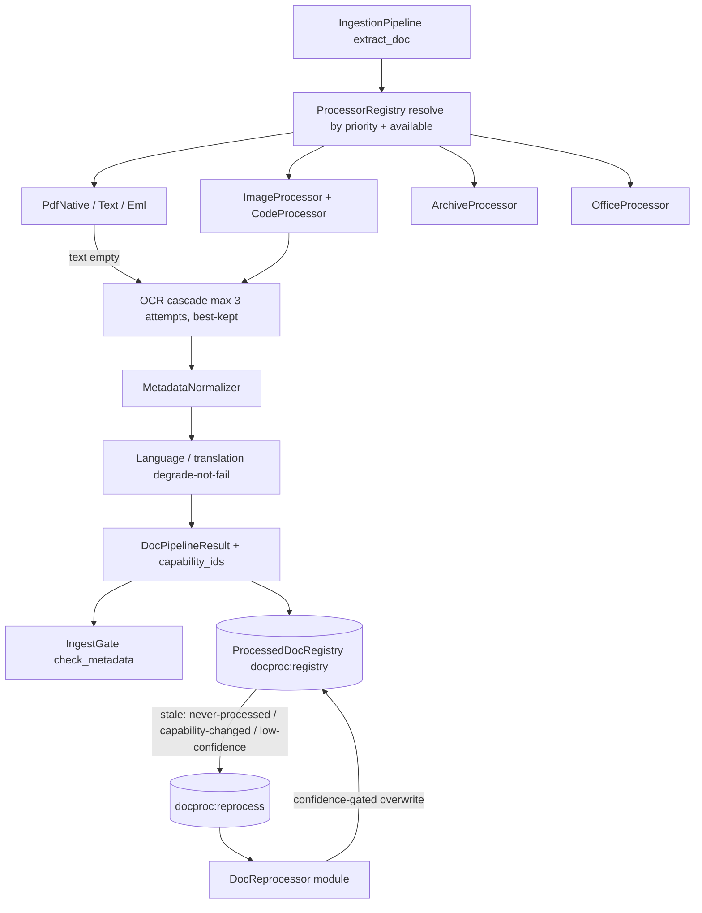

# Unified ingestion engine

Black Pearl collects from clear web / Tor / I2P crawls, chats, files and
feeds. Every source is normalized into one envelope before it reaches the
existing queue spine (`Importers -> Mixer -> Global`), so downstream
modules keep working unchanged. No existing entry point was removed:
existing importers/modules are untouched, and the new engine is additive.

## Architecture

```text
Feeder JSON / Chat JSON / Lacus capture / File / Feed / Importer relay
        |  bin/lib/ingest/adapters.py  (one IngestAdapter per source)
        v
IngestEnvelope  blackpearl.ingest/v1  (bin/lib/ingest/envelope.py)
  envelope_uuid, content_ref{sha256,size,mimetype}, typed attributes,
  immutable resource{service.name, source.id}, W3C traceparent, provenance[]
        |
        v
IngestionPipeline (bin/lib/ingest/pipeline.py) + IngestGate
  detect -> dedup_exact (sha256) -> extract -> normalize
        -> validate (strict, bin/lib/ingest/validate.py) -> dedup_fuzzy
        -> provenance_commit -> emit_legacy
        | pass                              | fail / duplicate
        v                                   v
legacy bridge: '<source> <b64(gzip(content))>'     DeadLetterQueue ingest:dlq
  (to_legacy_queue_message)                        + sighting only (dedup hit)
        v
Importers -> Mixer -> Global -> SaveObj / Item / Indexers (unchanged)
```



Components:

| Component | File | Role |
|---|---|---|
| Envelope | `bin/lib/ingest/envelope.py` | `IngestEnvelope` / `ContentRef` / `ProvenanceEvent`; `fork()` for archive children; W3C `traceparent` |
| Schema | `bin/lib/ingest/schema.py` | `AIL_OBJECTS` / MISP category-type allowlists |
| Validation | `bin/lib/ingest/validate.py` | Strict gate + `sanitize_text` (formula/scheme/control-char stripping) |
| Dedup | `bin/lib/ingest/dedup.py` | sha256 exact, metadata fingerprint, optional TLSH fuzzy |
| Provenance | `bin/lib/ingest/provenance.py` | Append-only events (`RECEIVE`, `FORK`, `DEDUP_HIT`, `VALIDATION_FAILED`, `REPLAY`, ...); Redis-optional (`prov:{uuid}`), in-memory fallback |
| Retry / DLQ | `bin/lib/ingest/retry.py` | `RetryPolicy` backoff, per-record penalize, processor yield, `DeadLetterQueue` (`ingest:dlq`) |
| Extraction | `bin/lib/ingest/extract.py` | `DocumentExtractor` facade: Tika REST first, Python fallback otherwise |
| Adapters | `bin/lib/ingest/adapters.py` | `IngestAdapter` ABC + 7 registered kinds (see below) |
| Pipeline | `bin/lib/ingest/pipeline.py` | `IngestionPipeline`, `IngestGate`, `to_legacy_queue_message` bridge |
| Config | `bin/lib/ingest/config.py` | INI / JSON / YAML pipeline loader |
| Queue importer | `bin/importer/UnifiedImporter.py` | Bridges envelopes to legacy Mixer queue format; `--dry-run` without Redis |
| Queue gate module | `bin/modules/IngestGate.py` | `TemplateModule`-pattern gate: subscribe `Importers-pre`, publish `Importers` |
| DLQ replay | `tools/ingest_replay.py` | `--list` / `--replay` / `--replay-all` / `--purge` |

Key invariants (all covered by tests):

- Malformed records go to the DLQ and never reach Mixer.
- Exact dedup hits emit a sighting only, never a second item.
- Extracted text is sanitised before indexing.
- Archives recurse into child envelopes via `fork()` (zip cap tested).
- The legacy bridge format is exactly `'<source> <b64(gzip(content))>'`,
  so `Mixer` / `Global` need no changes.

## Configuration

Pipeline stages are configured per source in `configs/ingest.cfg`
(INI; JSON/YAML with the same field names are also accepted as
`ingest.json` / `ingest.yaml` / `ingest.yml`). Loader:
`load_pipeline_config(path=None, source_id='default')` in
`bin/lib/ingest/config.py` — it searches `$AIL_HOME/configs/` then
`configs/`, and falls back to `default_pipeline()` when no file exists.

Shipped `configs/ingest.cfg`:

```ini
[ingest]
stages = detect_mimetype,dedup_exact,extract_doc,normalize,validate,dedup_fuzzy,provenance_commit,emit_legacy
gate_enabled = true
; tika_url = http://127.0.0.1:9998

[feeder]
stages = detect_mimetype,dedup_exact,normalize,validate,provenance_commit,emit_legacy
gate_enabled = true

[file]
stages = detect_mimetype,dedup_exact,extract_doc,normalize,validate,dedup_fuzzy,provenance_commit,emit_legacy
gate_enabled = true
```

| Field | Meaning | Default |
|---|---|---|
| `stages` | Comma-separated stage names, in order | `detect_mimetype,dedup_exact,extract_doc,normalize,validate,dedup_fuzzy,provenance_commit,emit_legacy` |
| `gate_enabled` | Run the strict `IngestGate` before emit | `true` |
| `tika_url` | Apache Tika server base URL (optional) | unset (fallback extractor) |

Per-stage tuning (JSON/YAML form only): each stage may be an object
`{name, enabled, max_retries, penalty_seconds, queue_count_limit,
queue_bytes_limit}` (`StageConfig` defaults: 3 retries, 30 s penalty,
10,000 records / 1 GiB queue limits).

JSON equivalent:

```json
{"source_id": "feeder", "gate_enabled": true, "tika_url": null,
 "stages": [{"name": "validate", "max_retries": 3, "penalty_seconds": 30.0}]}
```

Queue wiring (`configs/modules.cfg`, additive):

```ini
[UnifiedImporter]
publish = Importers

[IngestGate]
subscribe = Importers-pre
publish = Importers
```

Operational commands:

```bash
python3 bin/importer/UnifiedImporter.py   # queue importer (needs Redis/Kvrocks)
python3 tools/ingest_replay.py --list     # DLQ depth + entries
python3 tools/ingest_replay.py --replay-all
python3 tools/bench_ingest.py 2000        # benchmark, arg = iterations
```

## Adapter development guide

All adapters implement one interface in `bin/lib/ingest/adapters.py`:

```python
class IngestAdapter(ABC):
    source_id: str = "base"
    def fetch(self, raw_ref) -> Iterator[RawUnit]: ...   # abstract
    def normalize(self, raw: RawUnit) -> IngestEnvelope: ...  # default provided
    def health(self) -> dict: return {"source_id": self.source_id, "status": "ok"}
```

Registered kinds (`get_adapter(kind)` / `list_adapters()`; unknown kind
raises `ValueError`):

| Kind | Class | Wraps |
|---|---|---|
| `feeder` | `FeederJsonAdapter` | `FeederImporter` JSON `{source, meta, data, timestamp, source_uuid}`; `data` is b64-gzip / b64 / plain (strict base64, see note) |
| `chat` | `ChatAdapter` | Chat feeders (Telegram/Discord/Matrix/Rocket_Chat JSON); external collector still POSTs `api/v1/import/json/item` — there is no polling client in this repo |
| `crawler`, `website` | `WebsiteCrawlerAdapter` | Lacus captures / `CrawlerCapturesProcessor` payloads (`html`/`data`, `url`/`last_redirected_url`) |
| `file` | `FileAdapter` | `FileImporter`; binary files go through extraction instead of the old `is_text -> return None` rejection |
| `feed` | `FeedAdapter` | `LiveIntelFeedEngine` rows / RSS-JSON items (single item or list) |
| `importer` | `ImporterAdapter` | Sync/ZMQ-style relayed feeder payloads |

To add a new source:

1. Subclass `IngestAdapter`, set a unique `source_id`, implement
   `fetch(raw_ref)` yielding `RawUnit(source_id, content: bytes, meta,
   source_ref, source_timestamp)`. Raise the natural error for bad input
   (e.g. `FileAdapter` lets `FileNotFoundError` propagate) — the pipeline
   converts failures to retry/DLQ, so do not swallow them.
2. Override `normalize()` only to add typed attributes; call
   `super().normalize(raw)` first so `ContentRef` (sha256/size/mimetype),
   `source.kind`, and the `RECEIVE` provenance event are always set.
   Put extracted text in `env.content_text` (already sanitised downstream
   by `validate.sanitize_text` at the gate).
3. Register it: `ADAPTERS["mykind"] = MyAdapter` in `adapters.py`.
4. Add a `[mykind]` section to `configs/ingest.cfg` if it needs
   non-default stages (e.g. drop `extract_doc` for pure-text sources).
5. Add tests mirroring `tests/test_ingest_comprehensive.py`: fetch +
   normalize happy path, malformed input, and an end-to-end pipeline test
   asserting emit-on-pass / DLQ-on-fail.

Note on feeder decoding: `_decode_feeder_data` uses strict
`base64.b64decode(..., validate=True)`. Lenient decoding silently mangled
plain text (e.g. `'just text'` -> garbage); this was found and fixed
during comprehensive testing, and plain text now passes through as UTF-8.

Minimal example:

```python
from bin.lib.ingest.adapters import IngestAdapter
from bin.lib.ingest.envelope import RawUnit

class MyAdapter(IngestAdapter):
    source_id = "mysource"
    def fetch(self, raw_ref):
        yield RawUnit(source_id=self.source_id, content=str(raw_ref).encode(),
                      meta={}, source_ref="mysource://1")
    def normalize(self, raw):
        env = super().normalize(raw)
        env.attributes["source.kind"] = "mysource"
        env.content_text = raw.content.decode("utf-8", "ignore") or None
        return env
```

## Tooling setup (Tika / Serena / Context7)

These are optional. The engine runs without any of them.

### Apache Tika (document extraction)

`DocumentExtractor` tries Tika REST (`POST /rmeta`) when `tika_url` is
set/reachable and otherwise uses `PythonFallbackExtractor`
(PyMuPDF for PDF, stdlib `zipfile`/`email`/HTML parsing). Setup:

```bash
sudo dnf install -y java-17-amazon-corretto-headless   # Java 17+
# unpack the tika-server zip, then run it bound to localhost only:
java -jar tika-server-*.jar --host 127.0.0.1 --port 9998
```

Then uncomment `tika_url = http://127.0.0.1:9998` in `configs/ingest.cfg`.

Verification status on this host (re-checked for this document):
`java -version` -> `command not found` (exit 127), so the Tika server
cannot run here and the fallback extractor is the active, tested path.
The Python client (`tika==3.4.0`, installed only in a throwaway
`/tmp/tika-venv`) imports, but `parser.from_buffer` raises
`RuntimeError: Unable to start Tika server` without Java. Tika success
paths are therefore **not claimed as verified**; tests cover the
unreachable-Tika facade fallback (`127.0.0.1:1`). Do not add `tika` to
`requirements.txt` until a Java host verifies it end-to-end.

### Serena + Context7 (developer MCP tooling)

Configured in `.mcp.json` (gitignored local config — recreate it, do not
commit secrets):

```json
{"mcpServers": {
  "serena":   {"command": "serena", "args": ["start-mcp-server", "--context", "claude-code", "--project-from-cwd"]},
  "context7": {"command": "npx", "args": ["-y", "@upstash/context7-mcp@latest"]}}}
```

Optional: set `CONTEXT7_API_KEY` for higher Context7 limits (anonymous
limits apply otherwise); never commit the key.

Verification status (re-checked for this document): `serena --version`
-> `Serena 2.1.0`; `npx -y @upstash/context7-mcp@latest --help` prints
usage (transport/api-key flags) and exits 0. The servers are **not**
registered via `muse mcp add` against a live Muse session in
this run, and no Context7 API key is provisioned — treat both as
configured-and-launchable, not as live-integrated.

## Verified tests & benchmarks

Only results actually run are claimed. Re-run them with:

```bash
python3 -m unittest tests.test_ingest_comprehensive tests.test_ingest_engine
python3 tools/bench_ingest.py 2000
python3 tools/ingest_replay.py --list
```

| Check | Command | Verified result |
|---|---|---|
| Ingest tests | `python3 -m unittest tests.test_ingest_comprehensive tests.test_ingest_engine` | 68 tests OK (57 comprehensive + 11 engine), re-run for this document |
| Compile | `python3 -m py_compile bin/lib/ingest/*.py bin/importer/UnifiedImporter.py bin/modules/IngestGate.py tools/ingest_replay.py tools/bench_ingest.py tests/test_ingest_comprehensive.py` | OK |
| DLQ smoke | `python3 tools/ingest_replay.py --list` | `dlq_depth=0` |
| Importer smoke | `UnifiedImporter` dry-run, feeder payload | emitted 1; gzip-decodes to the smoke body (no Redis needed) |
| Other suites | `tests.test_deanonymization_engine`, `tests.test_module_extractor` | 4 OK, 3 OK |

Test coverage: envelope roundtrip/fork, validation rejects (bad
version/uuid/sha/trace, oversize, negative size, bad MISP/attribute
types, sanitize), dedup exact/metadata/fuzzy-absent, provenance
append-only + Redis-failure fallback, retry backoff/DLQ CRUD/replay,
extraction (HTML/JSON/EML multipart, nested zip + caps, corrupt input,
PDF-no-text, Tika-unreachable fallback), config INI/JSON/defaults, all
7 adapters, gate pass/malformed/dedup, end-to-end per source, and
flaky-normalize recovery (2 failures recover; 99 -> DLQ).

Benchmarks (`tools/bench_ingest.py`; feeder pipeline uses unique
payloads, zip has 10 files). Two runs on this host:

| Benchmark | Prior run (n=2000/1000/500) | Re-run for this doc (n=500) |
|---|---|---|
| `validate_envelope` | 276,587 rec/s, 0.003 ms mean | 248,496 rec/s, 0.004 ms mean |
| `dedup_exact` | 1,212,682 rec/s | 1,246,637 rec/s |
| `pipeline_ingest` (feeder) | 7,372 rec/s, 0.135 ms mean, 0.162 ms p95 | 6,843 rec/s, 0.146 ms mean, 0.228 ms p95 |
| `extract_zip` (10 files) | 755 rec/s, 1.323 ms mean | 750 rec/s, 1.333 ms mean |
| `extract_text` | 13,664 rec/s | 13,356 rec/s |

Not verified (environment limits, not hidden failures):

- Tika live-server extraction — no Java on this host (see above).
- Redis/Kvrocks live DLQ/provenance/dedup — no Redis server/module here;
  covered by failing-stub tests asserting in-memory fallback.
- Full AIL suite (`test_api`, `test_modules`, `test_api_crawler`,
  `test_language_bcp47`, web routes) fails pre-existing on missing
  `pyail`/`flask`/`redis` and unset `AIL_BIN`, on untouched code.
- Docling/unstructured bake-off was not run.

## Document processing (`bin/lib/ingest/processors/`)

The pipeline's `extract_doc` stage delegates to a processor chain in
`bin/lib/ingest/processors/`. `DocumentExtractor`
(`bin/lib/ingest/extract.py`) keeps its existing signatures and delegates
to `ProcessorRegistry`; a successful chain result is mapped to the legacy
`python-fallback` extractor name for callers that check it. Every
processor is optional-import / `available()`-gated, so a host without
Java, Tesseract or Paddle still ingests via the stdlib / PyMuPDF
fallback. Results flow back as `DocPipelineResult` (`text`, `metadata`,
`children`, `codes`, `confidence: StageConfidence`, `warnings`,
`errors: [StageError]`, `capability_ids`) and are forked into child
envelopes by `FileAdapter` (`children_meta` / `extracted_children`) and
indexed via `pdf` / `ocr` routes (`search_engine.py`, `Indexer.py`,
`PDFs.py`).

```text
                IngestionPipeline  extract_doc
                          |
                          v
            default_registry()  ProcessorRegistry
            resolve(mimetype, filename) -> sorted by priority,
                             only available() processors
                          |
        +-----------------+-----------------+-------------------+
        |                 |                 |                   |
        v                 v                 v                   v
    PdfNative         ImageProcessor    ArchiveProcessor    OfficeProcessor
    PdfOcr            OcrProcessor       (zip/tar*/gz/       (OOXML w:p/w:t
    PdfEmbedded       CodeProcessor       bz2/lzma stdlib)    runs + shared
    Text / Eml        (QR / barcode)     7z/rar -> Tika       Strings; OLE
                      cascade <= 3        warning)           -> Tika)
        +-----------------+-----------------+-------------------+
                          |
                          v
        run_doc_pipeline(): chain -> OCR cascade (if text empty)
            -> codes -> MetadataNormalizer -> language /
               translation (degrade-not-fail) -> DocPipelineResult
                          |
              +-----------+-----------+
              v                       v
    ProcessedDocRegistry        IngestGate check_metadata (layer-2)
    docproc:registry:{sha256}   + provenance CONTENT_MODIFIED
    docproc:reprocess queue
```



Components (all under `bin/lib/ingest/processors/` unless noted):

| Component | File | Role |
|---|---|---|
| Protocol | `base.py` | `BaseProcessor`, `Capability` (`capability_id = name@ver+engine#hash8`), `StageContext` / `StageResult` / `StageError`, `CodeResult`, `StageConfidence` (bands: `>= 0.85` accept, `0.60-0.85` accept-low, `< 0.60` reprocess; Tesseract TSV words with `conf < 0.60` dropped) |
| PDF | `pdf.py` | `PdfNativeProcessor` (PyMuPDF / `fitz` + embedded children), `PdfOcrProcessor` (OCRmyPDF `redo` -> `force` when native text is empty), `PdfEmbeddedProcessor` |
| Image / OCR / codes | `image.py` | `ImageProcessor` (+ EXIF), `OcrProcessor` (engine cascade, max 3 attempts, best result kept, emits `ocr:low-confidence`), `CodeProcessor` (`zxingcpp` -> `cv2` -> `pyzbar`; polygon / rect / `quality_raw`; `confidence=None` for the `cv2` path) |
| OCR engines | `ocr_engines.py` | `TesseractEngine` (`pytesseract` TSV), `OcrMyPdfEngine`, `PaddleEngine` (PaddleOCR v3 `rec_scores`, threshold `0.5`), `EasyOcrEngine` fallback; each `available()`-gated |
| Archive | `archive.py` | `zip` / `tar` / `tar.gz` / `gz` / `bz2` / `lzma` via stdlib; `7z` / `rar` degrade to a Tika warning |
| Office | `office.py` | OOXML parsed directly (`w:p` / `w:t` runs + `sharedStrings`); legacy OLE routed to Tika |
| Metadata | `metadata.py` | `MetadataNormalizer` (Tika / `fitz` / EXIF maps -> canonical `dc:*`, `file.*`, `doc.*`, `img.*`, `exif.*`, `pdf.*`, `archive.*` fields; PDF / EXIF dates -> ISO 8601; GPS IFD `34853` -> decimal; invalid `dc:language` dropped with a warning; `meta.raw:*` passed through without double-prefixing) |
| Language | `language.py` | Detection via `LanguagesDetector` / `lingua` when installed, stub fallback otherwise; `TranslationProvider` (`LibreTranslateProvider` / `ArgosOfflineProvider` / `NullProvider`) degrades to source text + `translation:unavailable`, never fails the pipeline |
| Near-dedup | `dedup_text.py` | `datasketch` MinHash (`num_perm=128`, 5-gram), LSH threshold `0.7` + verified Jaccard `>= 0.8` |
| Registry | `registry_store.py` | `ProcessedDocRegistry` (`docproc:registry:{sha256}`, `docproc:reprocess` queue; `is_current` / `stale_reason` / `should_overwrite` confidence-gated), in-memory fallback when Redis is absent |
| Orchestration | `__init__.py` | `ProcessorRegistry`, `default_registry()`, `run_doc_pipeline()` (chain -> OCR cascade -> codes -> metadata -> language; OOXML routed to `office`, not `archive`; binary-child sub-text appended to the parent) |
| Reprocess module | `bin/modules/DocReprocessor.py` | `AbstractModule` consumer for the `docproc:reprocess` queue |
| Facade | `bin/lib/ingest/extract.py` | `DocumentExtractor` delegates to the registry; signatures unchanged |

Canonical metadata fields were extended in `bin/lib/ingest/schema.py`
(`CANONICAL_DOC_FIELDS`: `dc:publisher`, `file.*`, `doc.*`, `img.*`,
`exif.*`, `pdf.*`, `archive.*`).

### Processor / adapter guide

A processor subclasses `BaseProcessor` (`base.py`), sets `name`,
`priority`, and `mimetypes` / `prefixes`, and implements
`process(ctx: StageContext) -> StageResult`. The registry resolves the
chain with `resolve(mimetype, filename)` — sorted by `priority`,
restricted to `available()` processors — and `run_doc_pipeline` stops
at the first non-empty text, then runs the OCR cascade, codes,
metadata and language stages. Unavailable engines are skipped, never
raise.

To add a document processor:

1. Subclass `BaseProcessor` in `bin/lib/ingest/processors/`, set a
   unique `name` and `priority`, and declare `mimetypes` / `prefixes`
   (or override `supports(mimetype, filename)`).
2. Implement `process()` returning a `StageResult` (`text`,
   `metadata`, `children`, `codes`, `confidence`). Use
   `self._timed(ctx, run)` so `StageError` / timing are recorded; do
   not raise for expected bad input — return an error entry instead.
3. Gate optional dependencies behind `available()` (import check /
   binary check) so hosts without the engine still ingest.
4. Register it in `default_registry()` (`__init__.py`) and, if it adds
   canonical fields, extend `CANONICAL_DOC_FIELDS` in `schema.py`.
5. Add tests mirroring `tests/test_doc_pipeline.py` (registry order /
   capability, happy path on a generated fixture, degrade path with
   the engine unavailable) and a corpus entry in
   `tests/docproc_corpus.py` if it changes extraction accuracy.

To add a source adapter, follow the existing guide above
(`IngestAdapter` in `bin/lib/ingest/adapters.py`); binary files are
extracted by `FileAdapter` through this processor chain instead of the
old `is_text -> return None` rejection.

### Configuration

`DocProcConfig` (`bin/lib/ingest/config.py`) is loaded as
`PipelineConfig.docproc` from the `[docproc]` INI section or the
`docproc` object in JSON / YAML. Shipped `configs/ingest.cfg`:

```ini
[docproc]
ocr_engine_order = ocrmypdf,tesseract,paddle,easyocr
ocr_accept = 0.85
ocr_reprocess_below = 0.60
tesseract_psm = 6
word_conf_min = 0.60
code_decoders = zxingcpp,cv2,pyzbar,qreader
minhash_enabled = false
lingua_enabled = false
translation_provider = libretranslate
max_embedded = 50
max_bytes = 20000000
```

| Field | Meaning | Default |
|---|---|---|
| `ocr_engine_order` | OCR cascade order tried by `OcrProcessor` | `ocrmypdf,tesseract,paddle,easyocr` |
| `ocr_accept` | `StageConfidence` accept band (`>=`) | `0.85` |
| `ocr_reprocess_below` | Below this confidence the doc is queued for reprocessing | `0.60` |
| `tesseract_psm` | Tesseract page-segmentation mode | `6` |
| `word_conf_min` | Tesseract TSV words below this `conf` are dropped | `0.60` |
| `code_decoders` | QR / barcode decoder order (`zxingcpp` -> `cv2` -> `pyzbar`) | `zxingcpp,cv2,pyzbar,qreader` |
| `minhash_enabled` | Enable MinHash near-dedup (`dedup_text.py`) | `false` |
| `lingua_enabled` | Enable `lingua` language detection when installed | `false` |
| `translation_provider` | `libretranslate` / `argos` / `null` (degrade-not-fail) | `libretranslate` |
| `max_embedded` | Max embedded children expanded per document | `50` |
| `max_bytes` | Max document bytes processed | `20000000` |

The pipeline passes the extractor through to the adapter
(`pipeline.py` -> `adapters.py`), records registry skip / record
decisions, emits `CONTENT_MODIFIED` provenance, and forks child
envelopes for embedded content.

### OCR reprocessing and historical reprocessing

Per-document (ingest time): when the primary chain yields no text for
an `image/*` or `application/pdf` input, `OcrProcessor` runs the
configured engine cascade (max 3 attempts, best result kept). A result
below `ocr_accept` (`0.85`) is kept but flagged; below
`ocr_reprocess_below` (`0.60`) the confidence band is `reprocess` and
the registry marks the document stale with reason `low-confidence`.
Tesseract word-level confidence below `word_conf_min` (`0.60`) is
dropped before the mean is computed.

Historical (batch): `ProcessedDocRegistry` stores one entry per
`sha256` (`docproc:registry:{sha256}`) with `capability_ids`,
`overall_confidence`, and `text_sha256`. A stored document is stale
when `stale_reason()` returns:

| Reason | Condition |
|---|---|
| `never-processed` | No registry entry for the `sha256` |
| `capability-changed` | Stored `capability_ids` differ from the current registry's (processor / engine version or config hash changed) |
| `low-confidence` | Stored `overall_confidence < 0.60` |

Operations:

```bash
# Enqueue / inspect / drain (ProcessedDocRegistry API, registry_store.py)
#   enqueue_reprocess(sha256, reason, requested_capability="")
#   dequeue_reprocess() / reprocess_depth()
#   is_current(sha256, current_capability_ids) / stale_reason(...)
#   should_overwrite(sha256, new_confidence)  # >= stored confidence only

# Queue consumer module (AbstractModule, pending_seconds pattern)
python3 bin/modules/DocReprocessor.py
```

`DocReprocessor` dequeues one item per `compute()`, re-fetches the
object file, re-runs `run_doc_pipeline`, and calls
`registry.record(...)` only when `should_overwrite` passes (new
confidence `>=` stored); otherwise the old result is kept and logged.
The parent envelope is preserved (reprocessing forks, it does not
replace history). With no Redis, both the registry and the queue fall
back to in-memory state.

### Install status (this host: Amazon Linux 2023, Python 3.12 `.venv-docproc`)

Re-checked for this document. "Installed" means the package / binary
is present; "Verified" means an end-to-end extraction was run by the
test suite / benchmark below. Do not treat "installed" as "verified".

| Component | Status | Evidence |
|---|---|---|
| PyMuPDF (`pymupdf` / `fitz`) | Verified | `PdfNativeProcessor` ran in 110-test suite + benchmark (PDF CER `0.0068`) |
| Pillow | Verified | Image / QR fixtures generated and decoded in the benchmark |
| OpenCV (`opencv-python-headless`) | Verified with caveat | `cv2` imports and `CodeProcessor` ran; `cv2.QRCodeEncoder` segfaults on this headless build, so QR fixtures are generated with the `qrcode` package instead |
| `zxing-cpp` (`zxingcpp` 3.1.1) | Verified | QR accuracy 5/5 in the benchmark |
| `datasketch` (MinHash) | Verified | Dedup pair accuracy 1.0 in the benchmark |
| `pytesseract` (Python wrapper) | Installed, engine blocked | Wrapper imports, but `TesseractEngine.available()` is `False` (no binary, see next row) |
| Tesseract (binary) | Blocked | `dnf` has no `tesseract` / `leptonica-devel` on AL2023; `tesseract: command not found`; `TesseractEngine.available()` -> `False` |
| OCRmyPDF (`ocrmypdf` 17.14.2 + `ghostscript` 9.56.1 + `qpdf` 10.6.3) | Installed, engine blocked | Python package + `gs` / `qpdf` present, but `OcrMyPdfEngine.available()` is `False` without the Tesseract binary; pipeline degrades to PyMuPDF text |
| PaddleOCR | Not installed (blocked) | `PaddleEngine.available()` -> `False`; isolated `.venv-paddle` install deferred (>500 MB + index risk) |
| EasyOCR | Not installed | `EasyOcrEngine.available()` -> `False`; kept as a cascade fallback |
| Apache Tika (3.3.3 jar + Java 17) | Installed, live extraction not verified | `java -version` -> `openjdk 17.0.21.1`; jar present at `/tmp/tika/tika.jar` (71 MB); server was not left running and no live `/rmeta` extraction is claimed — the `PythonFallbackExtractor` / processor chain is the tested path |

Setup on a Debian / Ubuntu host (where the blocked rows resolve):

```bash
uv venv .venv-docproc --python 3.12
uv pip install --python .venv-docproc/bin/python \
  pymupdf Pillow opencv-python-headless zxing-cpp datasketch \
  pytesseract ocrmypdf qrcode
sudo apt-get install -y tesseract-ocr   # or: dnf install tesseract (non-AL2023)
java -jar /tmp/tika/tika.jar --host 127.0.0.1 --port 9998  # optional Tika server
```

Then set `tika_url = http://127.0.0.1:9998` in `configs/ingest.cfg`
only after a live extraction has been verified on that host.

### Verified benchmarks

Methodology: synthetic ground-truth corpus independent of pipeline
output (`tests/docproc_corpus.py`: 18 items — 3 born-digital PDFs incl.
metadata / multi-page, 3 text incl. French / long, 5 QR PNGs with known
payloads (URL / WIFI / vCard / plain / long), 1 rendered-text PNG,
`docx`, `xlsx`, `zip`, `tar.gz`, `gzip`, `eml`; plus 5 dedup pairs).
Accuracy uses independent Levenshtein CER / WER
(`tests/benchmark_docproc.py`, `repeats=3`, single-host wall-clock,
first-PDF warmup included in per-item ms). Results are recorded in
`tests/fixtures/docproc/benchmark_results.json`; the suite is
`tests/test_doc_benchmark.py` (27 tests: corpus integrity, extraction
accuracy, QR, corrupt PDF / zip / docx, unsupported / empty /
corrupt-JPEG, OCR cascade stub `0.4 -> 0.92` / all-low best-kept /
accept-low band / max-3 attempts, metadata / date / EXIF /
invalid-language, language + translation fallback, near-dup pairs,
confidence band boundaries `0.85` / `0.60`, stage-error tracking,
historical reprocess roundtrip, benchmark smoke).

```bash
.venv-docproc/bin/python -m unittest tests.test_doc_benchmark tests.test_doc_pipeline tests.test_ingest_comprehensive tests.test_ingest_engine
.venv-docproc/bin/python tests/benchmark_docproc.py   # rewrites tests/fixtures/docproc/benchmark_results.json
```

Verified results (this host, re-run for this document):

| Check | Command | Verified result |
|---|---|---|
| Docproc + ingest tests | `.venv-docproc/bin/python -m unittest tests.test_doc_benchmark tests.test_doc_pipeline tests.test_ingest_comprehensive tests.test_ingest_engine` | 110 tests OK (83 prior + 27 benchmark), re-run for this document |
| Compile | `py_compile` on all touched files | OK |

| Category | n | Mean CER | Mean WER | Exact rate | Mean ms | Docs/s |
|---|---|---|---|---|---|---|
| `pdf` | 3 | 0.0068 | 0.0 | 1.0 | 24.53 | 40.77 |
| `text` | 3 | 0.0 | 0.0 | 1.0 | 0.06 | 16666.67 |
| `office` | 2 | 0.6666 | 1.0 | 0.5 | 0.23 | 4347.83 |
| `archive` | 3 | 0.3333 | 0.3333 | 0.6667 | 0.30 | 3333.33 |
| `eml` | 1 | 0.0 | 0.0 | 1.0 | 0.10 | 10000.0 |
| `image` (rendered text) | 1 | 1.0 | 1.0 | 0.0 | 111.96 | — |

| Signal | Verified result |
|---|---|
| QR accuracy (`zxingcpp`, 5 payloads incl. WIFI / vCard / long URL) | 5/5 = 1.0 exact |
| Near-dedup pair accuracy (MinHash, 5 ground-truth pairs) | 1.0 (exact `J=1.0`, near-swap detected, unrelated `J~0.023` rejected) |

Reading the numbers: `office` / `archive` CER is measured against a
single-string ground truth while the hypothesis contains all cells /
entries (`contains_gt=True` for every such item), so `exact_rate` is
the meaningful metric there. The `image` row is a degradation result,
not an OCR score: with every OCR engine unavailable the rendered-text
PNG yields empty text (`ocr produced no text`, CER `1.0`) and falls in
the `reprocess` band — asserted as a failure mode, not hidden. QR
images emit the same `ocr produced no text` warning alongside their
correct decode.

Bugs found by the benchmark and fixed (not assumed): metadata
double-prefix (`meta.raw:meta.raw:*`) on re-normalize;
`CodeProcessor` raising `UnidentifiedImageError` on PDF / non-image
bytes (now returns no codes); `ArchiveProcessor` polluting parent
text with binary nested-archive bytes; `run_doc_pipeline` dropping
nested / embedded child text when the primary text was non-empty.

Not verified (environment limits, not hidden failures):

- OCR accuracy (Tesseract / OCRmyPDF / Paddle / EasyOCR) — every
  engine reports `available() == False` on this host, so no CER / WER
  for scanned text is claimed; only the cascade / band behaviour with
  stub engines is tested.
- Language detection accuracy — the real `LanguagesDetector` / `lingua`
  detector is not installed here; the stub returns `[('en', 0.5)]` for
  French / Spanish text and translation resolves to `NullProvider`
  (`translate -> None`). Tests assert degrade-not-fail only.
- Live Tika server extraction — jar + Java are present but the server
  was not run end-to-end (see install table).
- Barcode (Code128 etc.) accuracy — `python-barcode` is absent; only
  QR via `zxingcpp` was measured.
- Encrypted (AES-256) PDF text — `pdf-native` records a `StageError`
  (`document closed or encrypted`), text stays empty and
  `pdf.encrypted` is not set (no password API in the contract).
- `tests/test_language_bcp47` — requires `AIL_HOME/configs/core.cfg`
  (only `core.cfg.sample` present); pre-existing environment blocker,
  fails before any docproc code runs.
- Thresholds `0.85` / `0.60`, TLSH `52`, MinHash `0.7` / `0.8` are
  starting points, not calibrated values.
