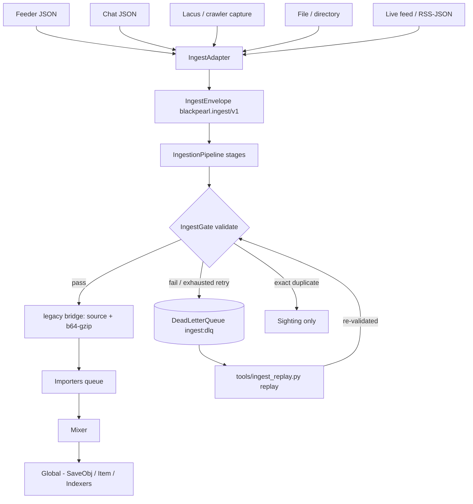

# Unified ingestion engine

Black Pearl collects from clear web / Tor / I2P crawls, chats, files and
feeds. Every source is normalized into one envelope before it reaches the
existing queue spine (`Importers -> Mixer -> Global`), so downstream
modules keep working unchanged. No existing entry point was removed:
existing importers/modules are untouched, and the new engine is additive.

## Architecture

```text
Feeder JSON / Chat JSON / Lacus capture / File / Feed / Importer relay
        |  bin/lib/ingest/adapters.py  (one IngestAdapter per source)
        v
IngestEnvelope  blackpearl.ingest/v1  (bin/lib/ingest/envelope.py)
  envelope_uuid, content_ref{sha256,size,mimetype}, typed attributes,
  immutable resource{service.name, source.id}, W3C traceparent, provenance[]
        |
        v
IngestionPipeline (bin/lib/ingest/pipeline.py) + IngestGate
  detect -> dedup_exact (sha256) -> extract -> normalize
        -> validate (strict, bin/lib/ingest/validate.py) -> dedup_fuzzy
        -> provenance_commit -> emit_legacy
        | pass                              | fail / duplicate
        v                                   v
legacy bridge: '<source> <b64(gzip(content))>'     DeadLetterQueue ingest:dlq
  (to_legacy_queue_message)                        + sighting only (dedup hit)
        v
Importers -> Mixer -> Global -> SaveObj / Item / Indexers (unchanged)
```



Components:

| Component | File | Role |
|---|---|---|
| Envelope | `bin/lib/ingest/envelope.py` | `IngestEnvelope` / `ContentRef` / `ProvenanceEvent`; `fork()` for archive children; W3C `traceparent` |
| Schema | `bin/lib/ingest/schema.py` | `AIL_OBJECTS` / MISP category-type allowlists |
| Validation | `bin/lib/ingest/validate.py` | Strict gate + `sanitize_text` (formula/scheme/control-char stripping) |
| Dedup | `bin/lib/ingest/dedup.py` | sha256 exact, metadata fingerprint, optional TLSH fuzzy |
| Provenance | `bin/lib/ingest/provenance.py` | Append-only events (`RECEIVE`, `FORK`, `DEDUP_HIT`, `VALIDATION_FAILED`, `REPLAY`, ...); Redis-optional (`prov:{uuid}`), in-memory fallback |
| Retry / DLQ | `bin/lib/ingest/retry.py` | `RetryPolicy` backoff, per-record penalize, processor yield, `DeadLetterQueue` (`ingest:dlq`) |
| Extraction | `bin/lib/ingest/extract.py` | `DocumentExtractor` facade: Tika REST first, Python fallback otherwise |
| Adapters | `bin/lib/ingest/adapters.py` | `IngestAdapter` ABC + 7 registered kinds (see below) |
| Pipeline | `bin/lib/ingest/pipeline.py` | `IngestionPipeline`, `IngestGate`, `to_legacy_queue_message` bridge |
| Config | `bin/lib/ingest/config.py` | INI / JSON / YAML pipeline loader |
| Queue importer | `bin/importer/UnifiedImporter.py` | Bridges envelopes to legacy Mixer queue format; `--dry-run` without Redis |
| Queue gate module | `bin/modules/IngestGate.py` | `TemplateModule`-pattern gate: subscribe `Importers-pre`, publish `Importers` |
| DLQ replay | `tools/ingest_replay.py` | `--list` / `--replay` / `--replay-all` / `--purge` |

Key invariants (all covered by tests):

- Malformed records go to the DLQ and never reach Mixer.
- Exact dedup hits emit a sighting only, never a second item.
- Extracted text is sanitised before indexing.
- Archives recurse into child envelopes via `fork()` (zip cap tested).
- The legacy bridge format is exactly `'<source> <b64(gzip(content))>'`,
  so `Mixer` / `Global` need no changes.

## Configuration

Pipeline stages are configured per source in `configs/ingest.cfg`
(INI; JSON/YAML with the same field names are also accepted as
`ingest.json` / `ingest.yaml` / `ingest.yml`). Loader:
`load_pipeline_config(path=None, source_id='default')` in
`bin/lib/ingest/config.py` — it searches `$AIL_HOME/configs/` then
`configs/`, and falls back to `default_pipeline()` when no file exists.

Shipped `configs/ingest.cfg`:

```ini
[ingest]
stages = detect_mimetype,dedup_exact,extract_doc,normalize,validate,dedup_fuzzy,provenance_commit,emit_legacy
gate_enabled = true
; tika_url = http://127.0.0.1:9998

[feeder]
stages = detect_mimetype,dedup_exact,normalize,validate,provenance_commit,emit_legacy
gate_enabled = true

[file]
stages = detect_mimetype,dedup_exact,extract_doc,normalize,validate,dedup_fuzzy,provenance_commit,emit_legacy
gate_enabled = true
```

| Field | Meaning | Default |
|---|---|---|
| `stages` | Comma-separated stage names, in order | `detect_mimetype,dedup_exact,extract_doc,normalize,validate,dedup_fuzzy,provenance_commit,emit_legacy` |
| `gate_enabled` | Run the strict `IngestGate` before emit | `true` |
| `tika_url` | Apache Tika server base URL (optional) | unset (fallback extractor) |

Per-stage tuning (JSON/YAML form only): each stage may be an object
`{name, enabled, max_retries, penalty_seconds, queue_count_limit,
queue_bytes_limit}` (`StageConfig` defaults: 3 retries, 30 s penalty,
10,000 records / 1 GiB queue limits).

JSON equivalent:

```json
{"source_id": "feeder", "gate_enabled": true, "tika_url": null,
 "stages": [{"name": "validate", "max_retries": 3, "penalty_seconds": 30.0}]}
```

Queue wiring (`configs/modules.cfg`, additive):

```ini
[UnifiedImporter]
publish = Importers

[IngestGate]
subscribe = Importers-pre
publish = Importers
```

Operational commands:

```bash
python3 bin/importer/UnifiedImporter.py   # queue importer (needs Redis/Kvrocks)
python3 tools/ingest_replay.py --list     # DLQ depth + entries
python3 tools/ingest_replay.py --replay-all
python3 tools/bench_ingest.py 2000        # benchmark, arg = iterations
```

## Adapter development guide

All adapters implement one interface in `bin/lib/ingest/adapters.py`:

```python
class IngestAdapter(ABC):
    source_id: str = "base"
    def fetch(self, raw_ref) -> Iterator[RawUnit]: ...   # abstract
    def normalize(self, raw: RawUnit) -> IngestEnvelope: ...  # default provided
    def health(self) -> dict: return {"source_id": self.source_id, "status": "ok"}
```

Registered kinds (`get_adapter(kind)` / `list_adapters()`; unknown kind
raises `ValueError`):

| Kind | Class | Wraps |
|---|---|---|
| `feeder` | `FeederJsonAdapter` | `FeederImporter` JSON `{source, meta, data, timestamp, source_uuid}`; `data` is b64-gzip / b64 / plain (strict base64, see note) |
| `chat` | `ChatAdapter` | Chat feeders (Telegram/Discord/Matrix/Rocket_Chat JSON); external collector still POSTs `api/v1/import/json/item` — there is no polling client in this repo |
| `crawler`, `website` | `WebsiteCrawlerAdapter` | Lacus captures / `CrawlerCapturesProcessor` payloads (`html`/`data`, `url`/`last_redirected_url`) |
| `file` | `FileAdapter` | `FileImporter`; binary files go through extraction instead of the old `is_text -> return None` rejection |
| `feed` | `FeedAdapter` | `LiveIntelFeedEngine` rows / RSS-JSON items (single item or list) |
| `importer` | `ImporterAdapter` | Sync/ZMQ-style relayed feeder payloads |

To add a new source:

1. Subclass `IngestAdapter`, set a unique `source_id`, implement
   `fetch(raw_ref)` yielding `RawUnit(source_id, content: bytes, meta,
   source_ref, source_timestamp)`. Raise the natural error for bad input
   (e.g. `FileAdapter` lets `FileNotFoundError` propagate) — the pipeline
   converts failures to retry/DLQ, so do not swallow them.
2. Override `normalize()` only to add typed attributes; call
   `super().normalize(raw)` first so `ContentRef` (sha256/size/mimetype),
   `source.kind`, and the `RECEIVE` provenance event are always set.
   Put extracted text in `env.content_text` (already sanitised downstream
   by `validate.sanitize_text` at the gate).
3. Register it: `ADAPTERS["mykind"] = MyAdapter` in `adapters.py`.
4. Add a `[mykind]` section to `configs/ingest.cfg` if it needs
   non-default stages (e.g. drop `extract_doc` for pure-text sources).
5. Add tests mirroring `tests/test_ingest_comprehensive.py`: fetch +
   normalize happy path, malformed input, and an end-to-end pipeline test
   asserting emit-on-pass / DLQ-on-fail.

Note on feeder decoding: `_decode_feeder_data` uses strict
`base64.b64decode(..., validate=True)`. Lenient decoding silently mangled
plain text (e.g. `'just text'` -> garbage); this was found and fixed
during comprehensive testing, and plain text now passes through as UTF-8.

Minimal example:

```python
from bin.lib.ingest.adapters import IngestAdapter
from bin.lib.ingest.envelope import RawUnit

class MyAdapter(IngestAdapter):
    source_id = "mysource"
    def fetch(self, raw_ref):
        yield RawUnit(source_id=self.source_id, content=str(raw_ref).encode(),
                      meta={}, source_ref="mysource://1")
    def normalize(self, raw):
        env = super().normalize(raw)
        env.attributes["source.kind"] = "mysource"
        env.content_text = raw.content.decode("utf-8", "ignore") or None
        return env
```

## Tooling setup (Tika / Serena / Context7)

These are optional. The engine runs without any of them.

### Apache Tika (document extraction)

`DocumentExtractor` tries Tika REST (`POST /rmeta`) when `tika_url` is
set/reachable and otherwise uses `PythonFallbackExtractor`
(PyMuPDF for PDF, stdlib `zipfile`/`email`/HTML parsing). Setup:

```bash
sudo dnf install -y java-17-amazon-corretto-headless   # Java 17+
# unpack the tika-server zip, then run it bound to localhost only:
java -jar tika-server-*.jar --host 127.0.0.1 --port 9998
```

Then uncomment `tika_url = http://127.0.0.1:9998` in `configs/ingest.cfg`.

Verification status on this host (re-checked for this document):
`java -version` -> `command not found` (exit 127), so the Tika server
cannot run here and the fallback extractor is the active, tested path.
The Python client (`tika==3.4.0`, installed only in a throwaway
`/tmp/tika-venv`) imports, but `parser.from_buffer` raises
`RuntimeError: Unable to start Tika server` without Java. Tika success
paths are therefore **not claimed as verified**; tests cover the
unreachable-Tika facade fallback (`127.0.0.1:1`). Do not add `tika` to
`requirements.txt` until a Java host verifies it end-to-end.

### Serena + Context7 (developer MCP tooling)

Configured in `.mcp.json` (gitignored local config — recreate it, do not
commit secrets):

```json
{"mcpServers": {
  "serena":   {"command": "serena", "args": ["start-mcp-server", "--context", "claude-code", "--project-from-cwd"]},
  "context7": {"command": "npx", "args": ["-y", "@upstash/context7-mcp@latest"]}}}
```

Optional: set `CONTEXT7_API_KEY` for higher Context7 limits (anonymous
limits apply otherwise); never commit the key.

Verification status (re-checked for this document): `serena --version`
-> `Serena 2.1.0`; `npx -y @upstash/context7-mcp@latest --help` prints
usage (transport/api-key flags) and exits 0. The servers are **not**
registered via `muse mcp add` against a live Muse session in
this run, and no Context7 API key is provisioned — treat both as
configured-and-launchable, not as live-integrated.

## Verified tests & benchmarks

Only results actually run are claimed. Re-run them with:

```bash
python3 -m unittest tests.test_ingest_comprehensive tests.test_ingest_engine
python3 tools/bench_ingest.py 2000
python3 tools/ingest_replay.py --list
```

| Check | Command | Verified result |
|---|---|---|
| Ingest tests | `python3 -m unittest tests.test_ingest_comprehensive tests.test_ingest_engine` | 68 tests OK (57 comprehensive + 11 engine), re-run for this document |
| Compile | `python3 -m py_compile bin/lib/ingest/*.py bin/importer/UnifiedImporter.py bin/modules/IngestGate.py tools/ingest_replay.py tools/bench_ingest.py tests/test_ingest_comprehensive.py` | OK |
| DLQ smoke | `python3 tools/ingest_replay.py --list` | `dlq_depth=0` |
| Importer smoke | `UnifiedImporter` dry-run, feeder payload | emitted 1; gzip-decodes to the smoke body (no Redis needed) |
| Other suites | `tests.test_deanonymization_engine`, `tests.test_module_extractor` | 4 OK, 3 OK |

Test coverage: envelope roundtrip/fork, validation rejects (bad
version/uuid/sha/trace, oversize, negative size, bad MISP/attribute
types, sanitize), dedup exact/metadata/fuzzy-absent, provenance
append-only + Redis-failure fallback, retry backoff/DLQ CRUD/replay,
extraction (HTML/JSON/EML multipart, nested zip + caps, corrupt input,
PDF-no-text, Tika-unreachable fallback), config INI/JSON/defaults, all
7 adapters, gate pass/malformed/dedup, end-to-end per source, and
flaky-normalize recovery (2 failures recover; 99 -> DLQ).

Benchmarks (`tools/bench_ingest.py`; feeder pipeline uses unique
payloads, zip has 10 files). Two runs on this host:

| Benchmark | Prior run (n=2000/1000/500) | Re-run for this doc (n=500) |
|---|---|---|
| `validate_envelope` | 276,587 rec/s, 0.003 ms mean | 248,496 rec/s, 0.004 ms mean |
| `dedup_exact` | 1,212,682 rec/s | 1,246,637 rec/s |
| `pipeline_ingest` (feeder) | 7,372 rec/s, 0.135 ms mean, 0.162 ms p95 | 6,843 rec/s, 0.146 ms mean, 0.228 ms p95 |
| `extract_zip` (10 files) | 755 rec/s, 1.323 ms mean | 750 rec/s, 1.333 ms mean |
| `extract_text` | 13,664 rec/s | 13,356 rec/s |

Not verified (environment limits, not hidden failures):

- Tika live-server extraction — no Java on this host (see above).
- Redis/Kvrocks live DLQ/provenance/dedup — no Redis server/module here;
  covered by failing-stub tests asserting in-memory fallback.
- Full AIL suite (`test_api`, `test_modules`, `test_api_crawler`,
  `test_language_bcp47`, web routes) fails pre-existing on missing
  `pyail`/`flask`/`redis` and unset `AIL_BIN`, on untouched code.
- Docling/unstructured bake-off was not run.
