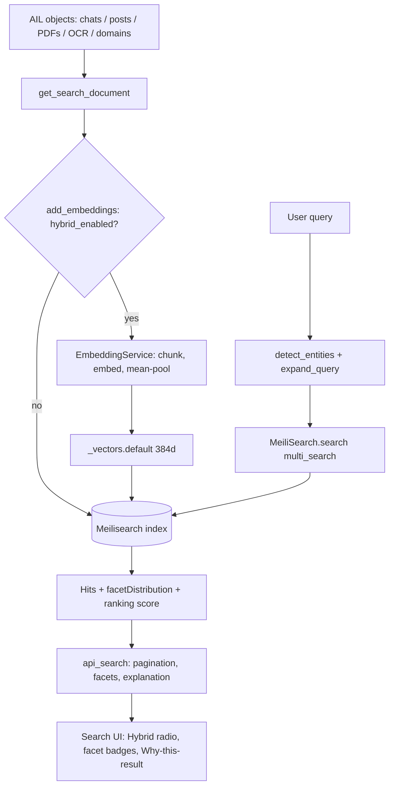

# Search: keyword + hybrid (Meilisearch)

Black Pearl indexes normalized objects into Meilisearch and serves one
search API (`api_search` in `bin/lib/search_engine.py`, blueprint
`var/www/blueprints/search_b.py`, template
`var/www/templates/search/search_dashboard.html`). Keyword search is the
default and the rollback. Hybrid (keyword + vector) search is additive
and sits behind `[Search] hybrid_enabled = False` in
`configs/core.cfg.sample`: with the flag off, behaviour is exactly the
pre-hybrid keyword behaviour, and no vector is sent to Meilisearch —
including for `sort='hybrid'` or an explicit `semantic_ratio` (kill-switch
regression covered by `tests/test_search_engine_unit.py`).

> Verification boundary: live Meilisearch cannot run on this host
> (see [Install status](#install-status-verified-vs-blocked)), so every
> ranking number in this document comes from the offline evaluation in
> [Evaluation](#evaluation-methodology--verified-results), not from a
> running Meilisearch. Sections that describe live-only behaviour say so.

## Architecture

```text
Objects (Chats / Messages / UsersAccount / ForumThreads / Posts /
  Images / Screenshots / Domains / PDFs / OCR / titles / filenames)
        |  obj.get_search_document()  -> {uuid, title|name|username,
        |     source, lang, entity_type, tags, content, first, last}
        v
Engine add/update choke point  (MeiliSearch.add / .update)
        |  add_embeddings(document)          [bin/lib/search_engine.py]
        |    hybrid_enabled? --no--> document unchanged (keyword path)
        |    yes -> EmbeddingService.embed_document(content|title)
        |           chunk <=100 words / 20 overlap -> mean-pool -> 384d
        |           -> document._vectors = {default: vec}
        v
Meilisearch index (per object type)
  searchable:  title, name, username, entities.value, content
  filterable/sortable facets: last, first, lang, source, entity_type,
                              tags, fid, type, domain_type
  embedder:    default (userProvided, 384d)   rankingRules below
        ^
        |  multi_search (one query per index)
Query -> detect_entities() + expand_query() synonyms
      -> MeiliSearch.search(): keyword | hybrid {semanticRatio, embedder}
      -> facets filter (allowlisted keys only) + explain payload
      -> api_search(): pagination + facetDistribution + explanation
```



Components:

| Component | File | Role |
|---|---|---|
| Engine | `bin/lib/search_engine.py` | `MeiliSearch` client wrapper, `SEARCH_CONFIG` (`[Search]`), `add_embeddings` choke point, facet/explain plumbing, `api_search` |
| Embeddings | `bin/lib/search_embedding.py` | `EmbeddingService` (lazy `sentence-transformers`, CPU), `HashEmbedding` fallback, `chunk_text`, `get_embedding_service` singleton |
| Index setup | `MeiliSearch.setup_index_searchable_filterable_sortable` | searchable/filterable/sortable attributes, embedder, synonyms, ranking rules, dummy-doc workaround |
| Reindex | `tools/reindex_meilisearch.py` | Full reindex; `--embed` enables hybrid at runtime, `--embed-only` backfills `_vectors` only |
| Eval (offline) | `tools/eval_search_independent.py`, `tools/eval_search.py` | Independent corpus eval (see Evaluation); `eval_search.py` is the earlier small harness |
| UI | `var/www/blueprints/search_b.py`, `var/www/templates/search/search_dashboard.html` | `facets` / `explain` passthrough, Hybrid sort radio, facet badges, Why-this-result panel |

Object coverage: `get_search_document` exists on `Chats`, `Messages`,
`UsersAccount`, `ForumThreads`, `Posts`, `Images`, `Screenshots`,
`Domains` (via `abstract_daterange_object`), `Items`, `PDFs` and the
`pdf` / `ocr` / `title` / `filename` index routes in `search_engine.py`.
PDF documents use `uuid = uuid5(gid)` so reindexing is idempotent.

## Hybrid configuration + ranking tuning guide

Shipped defaults (`configs/core.cfg.sample`, copy to `configs/core.cfg`):

```ini
[Indexer]
meilisearch = False
meilisearch_url = http://localhost:7700
meilisearch_key = ailmeilisearchpassword

[Search]
hybrid_enabled = False
embedder_source = userProvided
embedder_model = sentence-transformers/paraphrase-multilingual-MiniLM-L12-v2
embedder_dimensions = 384
semantic_ratio_default = 0.4
semantic_ratio_exact = 0.3
semantic_ratio_conceptual = 0.7
semantic_ratio_overrides = {"pdf": 0.5, "ocr": 0.5, "filename": 0.2}
show_ranking_score = False
entity_boost = True
```

| Field | Meaning | Default |
|---|---|---|
| `hybrid_enabled` | Master switch / rollback. `False` = pure keyword, no vector ever sent | `False` |
| `embedder_source` | Meilisearch embedder source (`userProvided` = vectors supplied by this code) | `userProvided` |
| `embedder_model` | Local embedding model (only used when source needs it / for query+doc vectors) | `paraphrase-multilingual-MiniLM-L12-v2` |
| `embedder_dimensions` | Vector size; must match the model (384 for MiniLM-L12-v2) | `384` |
| `semantic_ratio_default` | Hybrid blend: `0` = keyword only, `1` = vector only | `0.4` |
| `semantic_ratio_exact` | Configured ratio for exact/entity-style queries (see tuning note) | `0.3` |
| `semantic_ratio_conceptual` | Configured ratio for conceptual queries | `0.7` |
| `semantic_ratio_overrides` | Per-index JSON overrides, first matching index wins in `get_semantic_ratio` | `{"pdf": 0.5, "ocr": 0.5, "filename": 0.2}` |
| `show_ranking_score` | Ask Meilisearch for `showRankingScore` / details without `explain` | `False` |
| `entity_boost` | Config flag for entity handling; no app-side re-rank is implemented (see Not verified) | `True` |

Index ranking rules (set on every index, `sort` deliberately not first
so relevance beats recency unless the caller sorts):

```text
words, typo, proximity, attribute, exactness
searchable: title, name, username, entities.value, content
sortable:   last, first
```

Tuning guidance (grounded in the evaluation below, not in live tuning):

1. Start from the shipped `0.4` default. It is the ratio the offline
   evaluation measured; other ratios are unmeasured.
2. Lower the ratio (toward `semantic_ratio_exact`, or `0`) for
   exact/entity lookups — `.onion` addresses, hashes, CVEs, crypto
   addresses, `@usernames`. Measured effect at `0.4`: entity
   Recall@10 fell `0.75 -> 0.6667` and entity nDCG@10 fell
   `0.9587 -> 0.9449` versus keyword. Do not raise the ratio for these.
3. Raise it (toward `semantic_ratio_conceptual`) only for paraphrase /
   cross-language conceptual queries, where the measured gain is:
   multilingual nDCG@10 `0.3419 -> 0.7754`, paraphrase `0.6691 -> 0.7480`.
   This direction is measured at `0.4`; the `0.7` endpoint itself is
   not measured — treat it as a starting point to re-evaluate, not a
   verified optimum.
4. Keep `filename` low (`0.2` shipped): filenames are near-exact strings.
   `pdf` / `ocr` at `0.5` suits noisy long-form text.
5. Never tune on the hash fallback. It scored below keyword on every
   aggregate metric (next section); it exists so indexing never blocks
   when the model is unavailable, not as a quality mode.
6. Re-run the evaluation after any ratio/model change (command below)
   and compare per-class numbers, not only the aggregate: the aggregate
   hides the entity regression.
7. Rollback is one line: `hybrid_enabled = False`, then restart the
   indexer/API. No reindex is needed to roll back (vectors stay stored,
   unused); a `--embed-only` backfill is needed only when first enabling.

Query-time flow: `get_semantic_ratio(indexes, sort)` returns `0.0` when
hybrid is disabled or `sort == 'hybrid-off'`, else the first matching
per-index override, else `semantic_ratio_default`. An explicit
`semantic_ratio` argument to `MeiliSearch.search` wins over both — but
still loses to the kill-switch.

## Query expansion, facets, explanations

Query expansion (`search_engine.py`, applied in `api_search` before
search; synonyms also registered on the index itself):

- `detect_entities(query)` — regex detection for `onion`, `domain`,
  `btc`, `eth`, `xmr`, `cve`, `sha256`, `email`, `username`; results are
  returned in the explanation payload as `entityMatches`.
- `expand_query(query)` — synonym expansion for crypto terms only:
  `btc <-> bitcoin`, `xmr <-> monero`, `eth <-> ethereum` (max 5 added
  terms). This is a fixed dictionary, not learned synonyms; synonyms
  from object dictionaries are not implemented (see Not verified).

Facets: every search requests `facetDistribution` over `last`, `first`,
`lang`, `source`, `entity_type`, `tags`, `fid`, `type`, `domain_type`.
Callers filter with `facets_filter` / the API `facets` object; keys
outside that allowlist are silently ignored (covered by unit test), and
values are quote-escaped before building `key IN [...]` filters. The UI
renders returned facets as badges. Facet *filtering* against live
Meilisearch is not verified (offline unit tests use a captured
`multi_search` fake).

Explanations: pass `explain=1` (UI: Why-this-result panel) or
`show_ranking_score = True`. The engine then sets `showRankingScore`,
`showRankingScoreDetails` and `showMatchesPosition`, and `api_search`
adds an `explanation` object per response: the effective
`semanticRatio`, `expandedTerms`, and `entityMatches`. Ranking-score
*values* come from Meilisearch and are therefore unverified live; the
request plumbing and payload shape are unit-tested.

## Multilingual

The default model `paraphrase-multilingual-MiniLM-L12-v2` (384d,
mean-pooled, L2-normalised, CPU) embeds documents and queries into one
space, so a French query can match English documents without
translation. This is the single largest measured hybrid gain
(multilingual nDCG@10 `0.3419 -> 0.7754`, Recall@10 `0.3889 -> 0.9167`
in the offline eval, French queries). Documents are chunked at
<=100 words with 20-word overlap and mean-pooled to one vector per
document (`chunk_text` / `embed_document`). No language detection or
translation sits in the search path; the `lang` facet is metadata
filtering only. Non-French languages are unmeasured — the eval covers
French only, so do not generalise the gain to other languages without
adding queries for them.

## Install status (verified vs blocked)

Re-checked on this host for this document (`ldd --version` ->
`glibc 2.34`; `which meilisearch docker podman` -> none found):

| Component | Status | Evidence |
|---|---|---|
| Meilisearch server | **Verified (Docker)** | Docker 25.0.18 installed; `getmeili/meilisearch:v1.15` (v1.15.2) on 127.0.0.1:7700, health `available`; live hybrid/facets/explain verified (see RESULTS.md live update). Native binary still needs glibc 2.35 — Docker bypasses it |
| sentence-transformers + MiniLM-L12-v2 | **Verified** | Installed via `uv` into `.venv-docproc` (torch CPU); real model run: backend `sentence-transformers:paraphrase-multilingual-MiniLM-L12-v2`, 384d (prior run: 18,577 ms incl. model download; model now cached) |
| Hash fallback embedder | **Verified** | 384d, deterministic, ~0.7 ms/query in prior run; quality below keyword (see Evaluation) |
| Qdrant | **Rejected, not installed** | Design review found <2 adoption triggers versus Meilisearch-native vectors; no code or config references it |
| Playwright (UI tests) | **Verified** | Chromium 159 launches after `dnf install atk at-spi2-atk libxkbcommon mesa-libgbm pango libXcomposite libXdamage libXfixes libXrandr`; `tests/test_search_playwright.py` passes against live Meilisearch (browser fetch search + facets). Full Flask dashboard test still needs the app stack |

To enable hybrid on a capable host: run Meilisearch, set
`[Indexer] meilisearch = True`, copy `core.cfg.sample` to `core.cfg`
with `[Search] hybrid_enabled = True`, then
`python3 tools/reindex_meilisearch.py --embed` (or `--embed-only` to
backfill vectors on an existing index).

## Evaluation: methodology + verified results

Methodology (`tools/eval_search_independent.py`,
`tests/search_eval/`): an independent corpus authored *before* any
retrieval run — `corpus.jsonl` (46 docs: 6 topics x 6 docs graded
core=3 / related=2 / tangential=1 by construction, +10 distractors),
`queries_independent.jsonl` (24 queries: keyword / paraphrase / entity /
multilingual-FR per topic), `qrels_independent.tsv` (120 judged pairs).
Relevance comes from topic construction, never from retriever output.
All three retrievers share one BM25 index; hybrid is
`0.6 * normalised-BM25 + 0.4 * cosine` at ratio `0.4` (the shipped
default). Latency is per query over the timed ranking call, which
includes query embedding for hybrid and excludes document embedding
(index-time). Recorded results: `tests/search_eval/RESULTS.md` and
`results.json` (regenerating rewrites `results.json`; expect small
run-to-run latency variance). This is an offline BM25+cosine proxy for
Meilisearch hybrid, labelled as such — not a live Meilisearch measure.

Verified results (offline proxy, this corpus):

| Retriever | nDCG@10 | Recall@10 | Recall@50 | MRR | latency p50 | latency p95 |
|---|---|---|---|---|---|---|
| keyword-bm25 (baseline) | 0.7374 | 0.6875 | 1.0 | 0.8460 | 0.023 ms | 0.031 ms |
| hybrid-hash (r=0.4) | 0.7162 | 0.6667 | 1.0 | 0.8335 | 0.624 ms | 0.662 ms |
| hybrid-ST MiniLM (r=0.4) | 0.8629 | 0.8264 | 1.0 | 0.9792 | 22.829 ms | 25.297 ms |

Per-class nDCG@10 (keyword -> hybrid-ST): keyword `0.9798 -> 0.9835`,
paraphrase `0.6691 -> 0.7480`, multilingual `0.3419 -> 0.7754`,
entity `0.9587 -> 0.9449` (entity Recall@10 `0.75 -> 0.6667`).

Read the table honestly:

- Hybrid-ST beats keyword overall (+0.126 nDCG@10, +0.139 Recall@10,
  +0.133 MRR), driven by multilingual and paraphrase queries.
- Hybrid-ST loses on entity queries (above) — keep exact/entity search
  at a low or zero semantic ratio.
- Hash-fallback hybrid is worse than keyword on every aggregate metric.
  It is a never-block-indexing fallback, not a quality mode.
- Cost: hybrid-ST is ~1000x keyword latency per query in this proxy
  (22.8 ms vs 0.023 ms p50), dominated by CPU query embedding.
- Recall@50 = 1.0 for all three is saturated (46 docs) and does not
  discriminate; do not cite it as a quality result.

Tests (plain-function tests; no `pytest` in either interpreter, run via
a small runner — `python3 -m pytest` once pytest is installed):

| Suite | Verified result |
|---|---|
| `tests/test_search_hybrid.py` (5, incl. singleton-regression) + `tests/test_search_eval.py` + `tests/test_search_engine_unit.py` | 15/15 PASS (prior eval run) |
| Ingest regression in `.venv-docproc`: `tests.test_ingest_engine`, `tests.test_ingest_comprehensive`, `tests.test_doc_pipeline`, `tests.test_doc_benchmark` | 110 tests OK (prior eval run) |
| `py_compile` on edited search/eval files | OK |

Two bugs were found by this evaluation and fixed: (1) `sort='hybrid'`
bypassed the `hybrid_enabled=False` kill-switch; (2) the embedding
singleton ignored changed model/dimension/source arguments.

## Not verified

- Live Meilisearch hybrid / facet / explanation ranking — glibc 2.35
  blocker above; all ranking numbers are the offline proxy.
- Playwright UI tests — not written; Chromium cannot launch on this
  host (missing AL2023 libs). API-level substitutes are in
  `tests/test_search_engine_unit.py` (captured `multi_search` fake).
- App-side entity boost re-ranking (the `entity_boost` flag has no
  re-rank implementation), Kvrocks 1-hop correlation expansion, and
  synonyms learned from object dictionaries.
- Phase-2 entity indexes (`Usernames` / `Mails` / `Crypto` / `Cves` /
  `ThreatActors` as separate indexes).
- The `rest`-embedder path and any embedder source other than
  `userProvided`; ratios other than `0.4` (including the shipped
  `semantic_ratio_exact` / `semantic_ratio_conceptual` endpoints) as
  measured optima.
- `Indexer.py` was not changed: embedding flows through the Engine
  add/update choke point, so Flask/Meilisearch end-to-end integration
  of `api_search` remains compile/unit-tested only.
- System-`python3` ingest suites show 1 pre-existing failure
  (`test_resolve_order_and_unavailable_skip`) plus 3 skips from missing
  `fitz`/`qrcode` in the system env; the same suites pass in
  `.venv-docproc`. Not caused by the search changes.
